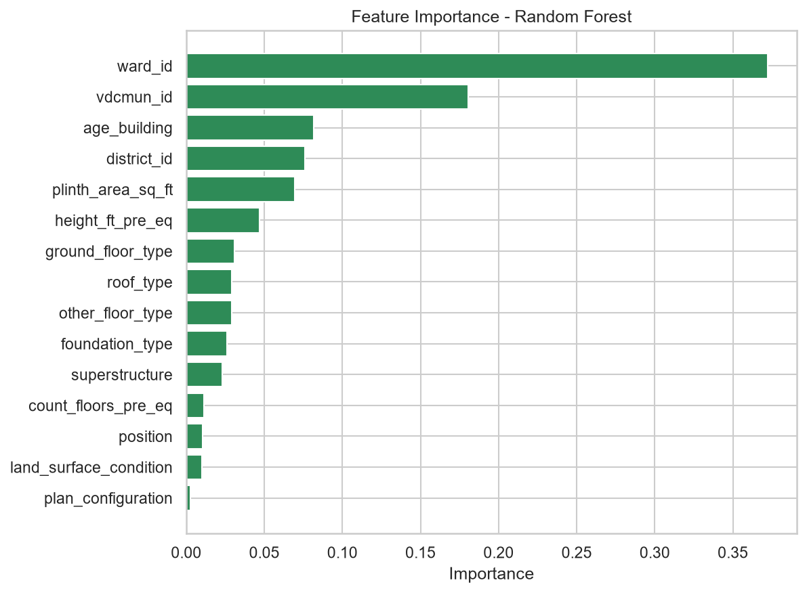

# Structural Damage Classification

Proyek klasifikasi multi kelas untuk memprediksi tingkat kerusakan bangunan pascagempa (`damage_grade`, Grade 1 sampai Grade 5) berdasarkan fitur struktural bangunan dan lokasinya. Proyek ini disusun untuk **Tugas 1 Supervised Machine Learning 2026** pada kompetisi Kaggle [Structural Damage Classification](https://www.kaggle.com/competitions/structural-damage-classification).

Model akhir berupa **Random Forest** yang dibungkus dalam `Pipeline` scikit-learn dengan `ColumnTransformer` untuk seluruh tahap preprocessing. Model Neural Network tidak digunakan sesuai ketentuan tugas.

## Identitas

* Nama: Kiranna Indy
* NRP: 5052241014
* Mata kuliah: Supervised Machine Learning
* Username Kaggle: kirannaindy
* Username GitHub: kirann41ndy

## Ringkasan Hasil

| Komponen | Hasil |
|---|---|
| Model akhir | Random Forest dalam Pipeline (ColumnTransformer dan RandomForestClassifier) |
| Hyperparameter terbaik | `n_estimators=150`, `max_depth=20`, `min_samples_leaf=3`, `class_weight="balanced_subsample"` |
| Macro F1 cross validation (2 fold) | 0,5389 |
| Accuracy validasi | 0,5745 |
| Macro F1 validasi | 0,5461 |

## Dataset

Data diunduh dari halaman kompetisi Kaggle dan terdiri dari empat file.
Link: https://www.kaggle.com/competitions/structural-damage-classification/data
Letakkan data pada folder data sesuai struktur repository dibawah

| File | Keterangan |
|---|---|
| `train.csv` | Data latih beserta target `damage_grade` (533.465 baris, 17 kolom) |
| `test.csv` | Data uji tanpa target (228.629 baris, 16 kolom) |
| `sample_submission.csv` | Contoh format file submission |
| `metadata.csv` | Penjelasan setiap variabel |

Target `damage_grade` pada data latih berupa label teks `Grade 1` sampai `Grade 5`, sedangkan file submission memakai angka 1 sampai 5. Konversi dilakukan pada `scripts/predict.py`.

Distribusi target pada data latih tidak seimbang.

| Kelas | Jumlah | Persentase |
|---|---|---|
| Grade 1 | 55.170 | 10,34% |
| Grade 2 | 61.080 | 11,45% |
| Grade 3 | 95.488 | 17,90% |
| Grade 4 | 128.691 | 24,12% |
| Grade 5 | 193.036 | 36,19% |

Fitur yang dipakai berjumlah 15, dengan perlakuan sebagai berikut.

| Kelompok | Kolom | Perlakuan |
|---|---|---|
| Numerik | `count_floors_pre_eq`, `age_building`, `plinth_area_sq_ft`, `height_ft_pre_eq` | Imputasi median |
| Kategorikal | `land_surface_condition`, `foundation_type`, `roof_type`, `ground_floor_type`, `other_floor_type`, `position`, `plan_configuration`, `superstructure` | Imputasi modus, lalu `OrdinalEncoder` |
| Lokasi | `district_id`, `vdcmun_id`, `ward_id` | Diubah menjadi string, lalu `TargetEncoder` |

Kolom `building_id` hanya berfungsi sebagai identitas dan tidak dipakai sebagai fitur.

## Struktur Repository

```
StructuralDamageClassification/
│
├── README.md
├── .gitignore
├── requirements.txt
│
├── data/
│   ├── .gitkeep
│   ├── train.csv
│   ├── test.csv
│   └── sample_submission.csv
│
├── notebooks/
│   ├── 01_eda.ipynb
│   ├── 02_modeling.ipynb
│   └── 03_submission.ipynb
│
├── scripts/
│   ├── __init__.py
│   ├── preprocess.py
│   ├── feature_engineering.py
│   ├── train.py
│   └── predict.py
│
├── models/
│   ├── .gitkeep
│   └── pipeline_model_rf.pkl
│
├── submissions/
│   └── submission.csv
│
└── reports/
    └── figures/
        └── feature_importance.png
```

| Folder atau file | Fungsi |
|---|---|
| `README.md` | Dokumentasi utama proyek |
| `.gitignore` | Daftar file yang tidak di commit (data, model besar, cache, environment) |
| `requirements.txt` | Dependency Python |
| `data/` | Dataset dari Kaggle (tidak di commit) |
| `notebooks/` | Notebook eksplorasi, eksperimen, dan pembuatan submission |
| `scripts/` | Source code modular |
| `models/` | Pipeline model yang sudah dilatih (dibuat secara lokal, tidak di commit) |
| `submissions/` | File submission CSV |
| `reports/figures/` | Gambar hasil analisis |

Isi modul pada `scripts/`:

* `preprocess.py`: path proyek, definisi kolom, pemuatan data, pembagian data latih dan validasi, serta `build_preprocessor()` yang menghasilkan `ColumnTransformer`.
* `feature_engineering.py`: pembersihan data dan pembentukan fitur (`build_features`), dipakai bersama oleh tahap training dan prediksi agar definisi fitur selalu konsisten.
* `train.py`: pembuatan pipeline, tuning, evaluasi, perhitungan feature importance, dan penyimpanan model.
* `predict.py`: pemuatan model, prediksi data uji, validasi format, dan penyimpanan submission.

**Catatan ukuran model.** File `models/pipeline_model_rf.pkl` berukuran sekitar 354,5 MB, melebihi batas 100 MB per file pada GitHub. Karena itu file model tidak di commit (dikecualikan pada `.gitignore`) dan harus dibuat ulang secara lokal dengan menjalankan `python -m scripts.train --tune` (lihat bagian Cara Penggunaan).

## Cara Penggunaan

### 1. Clone repository dan siapkan environment

```bash
git clone https://github.com/kirann41ndy/StructuralDamageClassification.git
cd StructuralDamageClassification

python -m venv venv
# Windows
venv\Scripts\activate
# macOS atau Linux
source venv/bin/activate

pip install -r requirements.txt
```

Proyek dikembangkan dengan Python 3.13.

### 2. Unduh data

Terima aturan kompetisi terlebih dahulu pada halaman web Kaggle, lalu unduh data dengan salah satu cara berikut.

Cara manual: buka tab **Data** pada halaman kompetisi, klik **Download All**, lalu ekstrak `train.csv`, `test.csv`, dan `sample_submission.csv` ke folder `data/`.

Cara command line (membutuhkan Kaggle API token):

```bash
kaggle competitions download -c structural-damage-classification -p data/
```

Setelah diunduh, ekstrak file zip ke folder `data/`. Dataset tidak di commit ke GitHub (lihat `.gitignore`).

### 3. Latih model

Jalankan dari root repository.

```bash
# Training dengan tuning RandomizedSearchCV (menghasilkan model akhir)
python -m scripts.train --tune

# Training dengan parameter bawaan (baseline)
python -m scripts.train

# Uji cepat memakai N baris saja
python -m scripts.train --sample 10000
```

Keluaran: `models/pipeline_model_rf.pkl` dan `reports/figures/feature_importance.png`. Model akhir pada laporan ini dihasilkan dengan opsi `--tune`.

### 4. Buat submission

```bash
python -m scripts.predict
```

Skrip ini memuat model, memprediksi `data/test.csv`, memvalidasi format terhadap `sample_submission.csv`, lalu menyimpan `submissions/submission.csv`. Alternatifnya, jalankan `notebooks/03_submission.ipynb`.

### 5. Submit ke Kaggle

```bash
kaggle competitions submit -c structural-damage-classification -f submissions/submission.csv -m "Random Forest pipeline tuned"
```

Pengunggahan juga dapat dilakukan melalui tab **Submit Prediction** pada halaman kompetisi.

### 6. Menjalankan notebook

Jalankan notebook secara berurutan: `01_eda.ipynb`, `02_modeling.ipynb`, lalu `03_submission.ipynb`. Notebook `02_modeling.ipynb` dan `03_submission.ipynb` mencari root repository secara otomatis, sehingga dapat dijalankan dari folder `notebooks/`. Pada `01_eda.ipynb`, path file data perlu disesuaikan dengan lokasi folder `data/` di komputer Anda.

## Alur Analisis

1. **Eksplorasi data (`01_eda.ipynb`).** Pemeriksaan kualitas data, statistika deskriptif, outlier, korelasi, distribusi target, hubungan fitur kategorikal dengan target (stacked bar dan Cramér's V), analisis lokasi, serta konsistensi data latih dan data uji. Temuan utama dirangkum pada bagian Laporan Interpretasi.
2. **Pembersihan data.** Nilai 999 pada `age_building` bermakna usia tidak diketahui (2.198 baris pada data latih dan 946 baris pada data uji, sekitar 0,41%), sehingga diganti menjadi `NaN` dan diimputasi di dalam pipeline. Kolom lokasi diubah menjadi string karena ID lokasi tidak memiliki urutan atau jarak yang bermakna.
3. **Pembagian data.** Data latih dibagi menjadi 426.772 baris data latih dan 106.693 baris data validasi (proporsi 80 banding 20) secara stratified dengan `random_state=42`. Proporsi kelas pada kedua bagian identik dengan data asli.
4. **Pembuatan pipeline.** Preprocessing dan model digabung dalam satu `Pipeline`.
5. **Model baseline.** Random Forest dengan parameter bawaan.
6. **Tuning.** `RandomizedSearchCV` dengan scoring macro F1.
7. **Evaluasi.** Accuracy, macro F1, classification report, dan confusion matrix pada data latih dan data validasi.
8. **Feature importance dan penyimpanan model.**
9. **Prediksi dan submission (`03_submission.ipynb`).** Prediksi data uji, validasi format, penyimpanan `submission.csv`, dan pengunggahan ke Kaggle.

## Pipeline dan ColumnTransformer

Seluruh preprocessing berada di dalam pipeline, sehingga statistik yang dipelajari (median, modus, rata-rata target per lokasi) hanya berasal dari data latih saat `fit`. Dengan demikian tidak terjadi kebocoran data (data leakage) ke data validasi maupun data uji.

```
Pipeline
├── prep (ColumnTransformer)
│   ├── numeric   : SimpleImputer(median)
│   ├── categoric : SimpleImputer(most_frequent) lalu OrdinalEncoder
│   └── location  : TargetEncoder
└── algo : RandomForestClassifier
```

Alasan pemilihan teknik:

* **Imputasi median** pada fitur numerik tahan terhadap pencilan. Outlier pada `plinth_area_sq_ft`, `height_ft_pre_eq`, dan `age_building` tidak dihapus karena nilainya wajar secara fisik dan model berbasis pohon tidak sensitif terhadapnya.
* **OrdinalEncoder** pada fitur kategorikal struktur bangunan cukup untuk model berbasis pohon, serta tidak menambah dimensi fitur. Kategori yang tidak pernah muncul pada data latih dikodekan sebagai `-1` (`handle_unknown="use_encoded_value"`) sebagai pengaman, meskipun hasil EDA menunjukkan tidak ada kategori baru pada data uji.
* **TargetEncoder** pada fitur lokasi karena kardinalitasnya tinggi (`ward_id` memiliki 945 nilai). One hot encoding akan membuat dimensi fitur meledak. `TargetEncoder` bawaan scikit-learn memakai cross fitting untuk mengurangi kebocoran target saat pelatihan. Pada target multi kelas, encoder ini menghasilkan satu kolom per kelas untuk setiap fitur lokasi.

## Model dan Tuning

Model yang digunakan adalah `RandomForestClassifier` dengan `random_state=42`.

Parameter baseline (bawaan):

| Parameter | Nilai |
|---|---|
| `n_estimators` | 150 |
| `max_depth` | 20 |
| `min_samples_leaf` | 5 |
| `class_weight` | tidak diatur |

Ruang pencarian pada `RandomizedSearchCV` (opsi `--tune`, `n_iter=4`, `cv=2`, `scoring="f1_macro"`):

| Parameter | Kandidat |
|---|---|
| `n_estimators` | 50, 100, 150 |
| `max_depth` | 10, 20, 30, 40 |
| `min_samples_leaf` | 3, 5, 10 |
| `class_weight` | `None`, `balanced`, `balanced_subsample` |

Parameter terbaik hasil tuning (macro F1 cross validation 0,5389) digunakan pada model akhir:

| Parameter | Nilai |
|---|---|
| `n_estimators` | 150 |
| `max_depth` | 20 |
| `min_samples_leaf` | 3 |
| `class_weight` | `balanced_subsample` |

Perbandingan model:

| Model | Accuracy latih | Macro F1 latih | Accuracy validasi | Macro F1 validasi |
|---|---|---|---|---|
| Baseline | 0,6341 | 0,6007 | 0,5830 | 0,5382 |
| Tuned (model akhir) | 0,6325 | 0,6148 | 0,5745 | 0,5461 |

## Laporan Interpretasi

### Temuan eksplorasi data

* **Kualitas data.** Tidak ada missing value dan tidak ada baris duplikat. Placeholder 999 pada `age_building` merusak statistik: rata-rata usia 20,3 tahun tanpa nilai 999 dan 24,3 tahun dengan nilai 999.
* **Target tidak seimbang.** Grade 5 mencapai 36,2% sedangkan Grade 1 hanya 10,3% (kelas terbesar sekitar 3,5 kali kelas terkecil). Karena itu digunakan split stratified dan macro F1 selain accuracy.
* **Fitur numerik.** Korelasi tinggi hanya antara `height_ft_pre_eq` dan `count_floors_pre_eq` (r = 0,71). Hubungan fitur numerik dengan target lemah (Spearman di bawah 0,25), yang paling kuat `age_building` (0,24).
* **Material struktur adalah pembeda kuat.** Bangunan beton bertulang hanya 1 sampai 12% yang rusak berat (Grade 4 dan 5), sedangkan bangunan lumpur dan batu 65 sampai 75%.
* **Lokasi adalah sinyal terkuat.** Nilai Cramér's V terhadap target tertinggi dimiliki `ward_id` (0,447), `vdcmun_id` (0,369), dan `district_id` (0,301), lebih tinggi daripada seluruh fitur struktur. Persentase rusak berat antar district berkisar dari 20,8% sampai 92,6%. Lokasi kemungkinan mewakili kedekatan dengan pusat gempa dan intensitas guncangan, informasi yang tidak ditangkap fitur bangunan.
* **Fitur hampir tidak informatif.** `plan_configuration`, `position`, dan `land_surface_condition` memiliki Cramér's V di bawah 0,06.
* **Konsistensi data latih dan data uji.** Tidak ada kategori baru pada data uji dan proporsi tiap kategori hampir identik (selisih terbesar kurang dari 0,2 poin persen), sehingga tidak ada indikasi data drift.

### Kinerja model

Model akhir mencapai macro F1 validasi 0,5461 dan accuracy validasi 0,5745.

* **Overfitting moderat.** Macro F1 data latih (0,6148) lebih tinggi daripada data validasi (0,5461), selisih sekitar 0,07.
* **Dampak tuning.** Tuning menaikkan macro F1 validasi dari 0,5382 menjadi 0,5461, tetapi menurunkan accuracy dari 0,5830 menjadi 0,5745. Penyebabnya adalah `class_weight="balanced_subsample"` yang membuat model lebih memperhatikan kelas minoritas. Recall Grade 2 naik dari 0,30 menjadi 0,43 dan Grade 1 dari 0,73 menjadi 0,77, sedangkan recall Grade 5 turun dari 0,77 menjadi 0,68. Karena tujuan utama adalah kinerja yang adil antar kelas, macro F1 dijadikan acuan.
* **Perbedaan antar kandidat tuning cukup besar.** Empat kandidat menghasilkan macro F1 cross validation antara 0,4976 dan 0,5389, sehingga hyperparameter berpengaruh nyata.

Classification report model akhir pada data validasi:

| Kelas | Precision | Recall | F1 | Support |
|---|---|---|---|---|
| Grade 1 | 0,58 | 0,77 | 0,66 | 11.034 |
| Grade 2 | 0,38 | 0,43 | 0,40 | 12.216 |
| Grade 3 | 0,43 | 0,43 | 0,43 | 19.098 |
| Grade 4 | 0,52 | 0,51 | 0,52 | 25.738 |
| Grade 5 | 0,77 | 0,68 | 0,72 | 38.607 |
| Macro average | 0,54 | 0,56 | 0,55 | 106.693 |

### Feature importance

Importance dari kolom hasil target encoding dijumlahkan kembali ke fitur lokasi asalnya, sehingga grafik berisi 15 fitur dengan total importance sama dengan 1.



| Fitur | Importance |
|---|---|
| `ward_id` | 0,3723 |
| `vdcmun_id` | 0,1805 |
| `age_building` | 0,0816 |
| `district_id` | 0,0761 |
| `plinth_area_sq_ft` | 0,0695 |
| `height_ft_pre_eq` | 0,0469 |
| `ground_floor_type` | 0,0309 |
| `roof_type` | 0,0291 |
| `other_floor_type` | 0,0290 |
| `foundation_type` | 0,0262 |
| `superstructure` | 0,0232 |
| `count_floors_pre_eq` | 0,0113 |
| `position` | 0,0105 |
| `land_surface_condition` | 0,0101 |
| `plan_configuration` | 0,0025 |

* **Lokasi mendominasi.** Tiga fitur lokasi menyumbang sekitar 62,9% total importance, dengan `ward_id` saja 37,2%. Hal ini sejalan dengan hasil EDA bahwa lokasi adalah sinyal terkuat.
* **Material struktur terbagi.** Lima fitur material (lantai dasar, atap, lantai lain, fondasi, dan superstruktur) menyumbang sekitar 13,8% secara gabungan. Nilai per fitur kecil karena fitur-fitur ini menggambarkan hal yang saling terkait, yaitu tipe konstruksi, sehingga kontribusinya terbagi di antara mereka.
* **Fitur numerik.** `age_building`, `plinth_area_sq_ft`, dan `height_ft_pre_eq` cukup berperan. Fitur `count_floors_pre_eq` rendah, kemungkinan karena informasinya sudah terwakili oleh `height_ft_pre_eq` (r = 0,71).
* **Fitur lemah.** `position`, `land_surface_condition`, dan `plan_configuration` berkontribusi sangat kecil, konsisten dengan Cramér's V yang rendah pada EDA.
* **Catatan kehati-hatian.** Importance berbasis impurity cenderung menguntungkan fitur dengan banyak nilai unik atau bersifat kontinu. Setelah target encoding, fitur lokasi berbentuk kontinu, sehingga porsi lokasi kemungkinan sebagian terlalu besar. Interpretasi ini menunjukkan urutan kepentingan, bukan hubungan sebab akibat.

### Analisis kesalahan

Confusion matrix model akhir pada data validasi:

| Aktual \ Prediksi | Grade 1 | Grade 2 | Grade 3 | Grade 4 | Grade 5 |
|---|---|---|---|---|---|
| Grade 1 | 8.454 | 1.719 | 413 | 243 | 205 |
| Grade 2 | 2.986 | 5.255 | 2.508 | 965 | 502 |
| Grade 3 | 1.673 | 3.708 | 8.135 | 3.821 | 1.761 |
| Grade 4 | 758 | 1.775 | 4.826 | 13.197 | 5.182 |
| Grade 5 | 716 | 1.465 | 3.127 | 7.045 | 26.254 |

* **Kesalahan terkonsentrasi pada grade bersebelahan.** Dari 45.398 prediksi yang salah, sekitar 70% (31.795) hanya berselisih satu grade. Ini wajar karena `damage_grade` bersifat ordinal, dengan batas antar grade yang tidak tegas.
* **Kelas tengah paling sulit.** Grade 2 (F1 0,40) dan Grade 3 (F1 0,43) paling sering tertukar dengan kelas di sekitarnya. Misalnya, bangunan Grade 3 hampir sama banyak diprediksi sebagai Grade 2 (3.708) dan Grade 4 (3.821).
* **Kelas ekstrem lebih mudah.** Grade 5 (F1 0,72) dan Grade 1 (F1 0,66) lebih mudah dikenali. Namun sekitar 18% bangunan Grade 5 (7.045 dari 38.607) diprediksi sebagai Grade 4.
* **Ketimpangan kelas berpengaruh.** Pembobotan kelas memperbaiki recall kelas minoritas tetapi menurunkan recall Grade 5, yaitu perpindahan keseimbangan antara kelas besar dan kecil.

### Keterbatasan dan saran pengembangan

* Pencarian hyperparameter hanya mencoba 4 kombinasi dengan 2 fold, sehingga ruang pencarian belum dieksplorasi secara luas. Perluasan ruang pencarian atau penambahan jumlah iterasi berpotensi menaikkan skor.
* Model dapat dibandingkan dengan algoritma berbasis pohon lain (misalnya Gradient Boosting atau Extra Trees), selama bukan Neural Network.
* Klasifikasi saat ini memperlakukan kelas sebagai nominal, padahal `damage_grade` bersifat ordinal. Pendekatan yang memanfaatkan urutan kelas dapat mengurangi kesalahan antar grade bersebelahan.
* Fitur turunan belum dieksplorasi, misalnya rasio tinggi terhadap jumlah lantai atau interaksi antara lokasi dan material struktur, yang dapat ditambahkan pada `scripts/feature_engineering.py`.
* Ukuran model (sekitar 354,5 MB) cukup besar. Mengurangi `n_estimators` atau menaikkan `min_samples_leaf` dapat memperkecil ukuran, dengan kemungkinan penurunan kinerja.

## Catatan Submission

Submission dengan skor terbaik pada leaderboard berasal dari
percobaan awal. Kode percobaan tersebut tidak tersimpan, sehingga tidak disertakan pada repository ini. Repository ini berisi kode untuk submission akhir, dan seluruh laporan interpretasi pada README mengacu pada
model tersebut.

## Kesesuaian dengan Ketentuan Tugas

* Struktur repository mengikuti contoh tree structure pada panduan tugas.
* Dataset dan file model besar tidak di commit, dan `.gitignore` mengecualikan `data/*.csv` serta `models/*.pkl`.
* Cara mengunduh data didokumentasikan pada bagian Cara Penggunaan.
* Preprocessing, training, dan tuning memakai `Pipeline` dan `ColumnTransformer`.
* Setiap function pada file `.py` memiliki docstring (format Args, Returns, dan Raises).
* Tidak menggunakan model Neural Network.

## Referensi

* Halaman kompetisi: https://www.kaggle.com/competitions/structural-damage-classification
* Dokumentasi scikit-learn: https://scikit-learn.org/stable/
